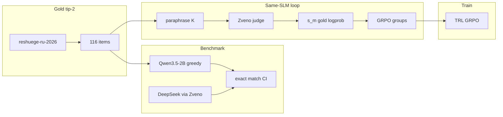

# Фреймворк генерации состязательных заданий, устойчивых к решению SLM

A Framework for Generating Adversarial Items Robust to SLM Solvers.

Evaluation target: Russian Unified State Exam Russian language Type 2 items. Gold set: [pymlex/reshuege-ru-2026](https://huggingface.co/datasets/pymlex/reshuege-ru-2026) (116 items). In code and docs the stem field is **text**. Highlights use `**...**`. Option labels use `1.` not `1)`.

Local SLM on Clore GPU: `Qwen/Qwen3.5-2B` (`SLM_MODEL_ID`). Strong solver and judge: `deepseek/deepseek-v4-flash-0731` via Zveno (`ZVENOAI_API_KEY`).

## Ubuntu Jupyter workflow (Clore)

Target hardware: NVIDIA RTX 4090 or newer, CUDA 12.4+ wheels, Ubuntu Jupyter.

### 1. Clone and install

```bash
git clone https://github.com/pymlex/unsolvable.git
cd unsolvable
bash scripts/install_ubuntu_jupyter.sh
```

The install script creates `.venv` even when `ensurepip` / `python3-venv` is broken on the image (get-pip + virtualenv fallback), installs CUDA torch from the cu124 index, then installs `requirements.txt`. On root Clore images it also links `/root/venv` to `.venv`.

Copy secrets if the script just created `.env`:

```bash
cp .env.example .env   # only when .env is missing
```

Set at least `HF_TOKEN` in `.env`. For DeepSeek solve/judge/synthesis also set `ZVENOAI_API_KEY`. Optional: `GITHUB_TOKEN`, `GITHUB_NAME`, `GITHUB_EMAIL`, `SLM_MODEL_ID`.

### 2. Tip-2 SLM benchmark on all 116 items

```bash
source .venv/bin/activate
bash scripts/run_benchmark_slm.sh
```

Equivalent one-liner after install:

```bash
python main.py --step benchmark-slm
```

Smoke run with a small cap:

```bash
bash scripts/run_benchmark_slm.sh 4
```

Results land under `results/benchmark/`:

| File | Content |
|---|---|
| `results/benchmark/slm_Qwen_Qwen3.5-2B.json` | per-item preds + summary |
| `results/benchmark/slm_Qwen_Qwen3.5-2B.md` | accuracy table with Wilson / bootstrap CI |

### 3. Other pipeline steps

```bash
python main.py --step benchmark-deepseek
python main.py --step probe-margin --limit 8
python main.py --step build-groups --limit 4
python main.py --step grpo-train --dry-run
python main.py --step synthesis --n-synth 4
```

Full automated SLM run plus optional DeepSeek and results push:

```bash
bash scripts/run_all.sh
```

Push controlled result paths:

```bash
bash scripts/push_results_github.sh "Publish tip-2 benchmark results"
```

## Project tree

```
unsolvable/
├── main.py, constants.py, requirements.txt, .env.example
├── schemas/          pydantic models
├── utils/            config_loader, paths
├── eval/             tip-2 SLM and DeepSeek benchmarks
├── generation/       paraphrase prompts
├── preferences/      s_m margin probe, GRPO groups
├── scoring/          answer log-prob
├── judge/            Zveno DeepSeek judge
├── synthesis/        synthetic tip-2 split
├── training/         GRPO
├── scripts/          install, run_benchmark_slm, run_all, push_*
├── docs/             pipeline, methods
└── results/          benchmark, preferences, groups, synthesis, plots
```

## Architecture



## Scale estimate

Detector-tricking used 8891 train abstracts and produced 6396 DPO pairs. Gold tip-2 has 116 items. Locked synthetic target for GRPO: **2000** items in split `train-deepseek-v4-flash-0731` (`SYNTHESIS_N_ITEMS=2000`).

## Docs

- [docs/pipeline.md](docs/pipeline.md) — benchmark, same-SLM loop, GRPO groups, synthetic split
- [docs/unsolvable-guide.md](docs/unsolvable-guide.md) — methods under the print constraint

## Licence

GPL-3.0. See [LICENSE](LICENSE).

```bibtex
@misc{unsolvable-2026,
  title={A Framework for Generating Adversarial Items Robust to {SLM} Solvers},
  author={{Фреймворк генерации состязательных заданий, устойчивых к решению SLM}},
  howpublished={https://github.com/pymlex/unsolvable},
  year={2026}
}

@misc{reshuege-ru-2026,
  title={reshuege-ru-2026: {EGE} Russian Type 2 items from Reshu {EGE}},
  author={{pymlex}},
  howpublished={https://huggingface.co/datasets/pymlex/reshuege-ru-2026},
  year={2026}
}
```

The project is under GPL-3.0 license.
