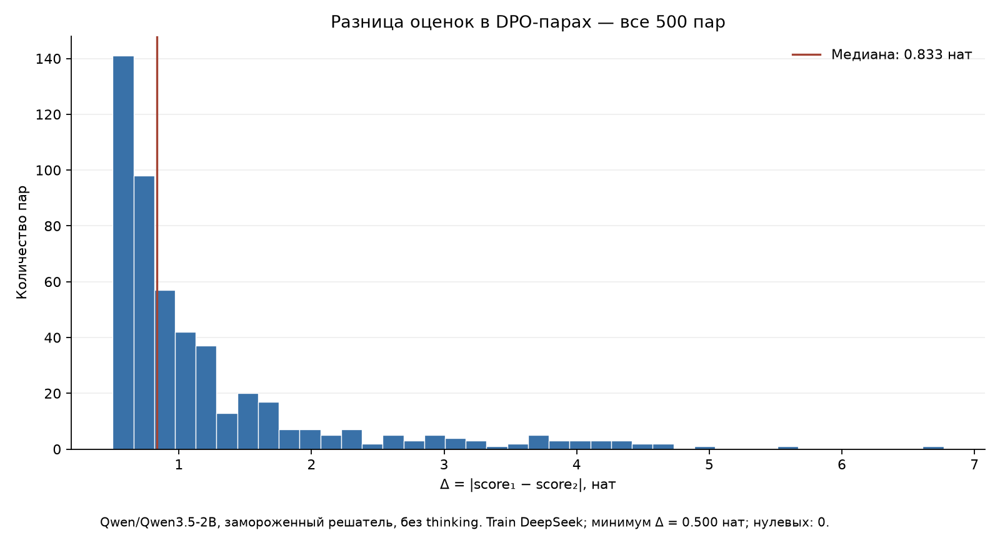

# Final 500 DPO training pairs

Every pair has a score difference strictly greater than 0.5 nats.

Minimum: 0.500489; median: 0.833147; mean: 1.195281 nats.

Score: sum of log probabilities of the gold answer plus EOS under the frozen no-thinking solver. Difference is between the two selected rewrites, not accuracy.

HF revision: `4ea922b243e9be1ea7546f803d8c31c251b05e20`. [HF data](https://huggingface.co/datasets/pymlex/reshuege-ru-2026/tree/4ea922b243e9be1ea7546f803d8c31c251b05e20/artifacts/dpo-qwen3.5-2b).
